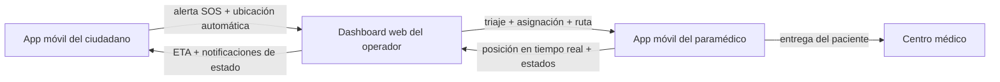
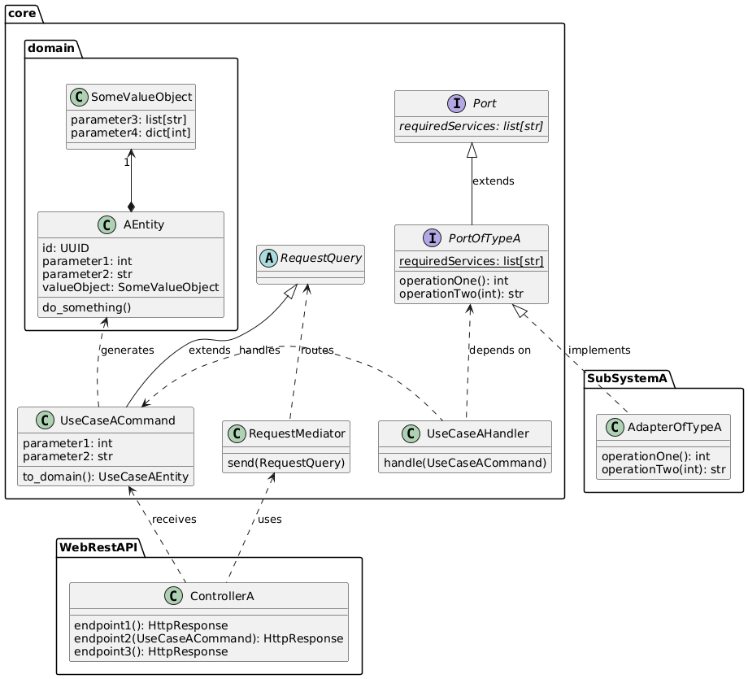

# SIEE — Sistema Integrado de Emergencias

> **SIEE** (_Sistema Integrado de Emergencias_, nombre del producto **SIE_emergency**) es una
> plataforma integrada de gestión de emergencias prehospitalarias. Conecta a **ciudadanos**,
> **operadores de emergencias**, **paramédicos** y **centros médicos** en un único flujo:
> desde una alerta SOS de un solo toque con geolocalización automática, pasando por el
> triaje asistido y la asignación de recursos, hasta la entrega del paciente y las
> analíticas históricas.

**Estado:** prototipo **académico** funcional y _demostrativo_, construido para el
contexto de gestión de emergencias del área metropolitana del Valle de Aburrá
(Colombia). No es un sistema en producción.

> 📸 **La captura principal va aquí** — p. ej. `docs/screenshots/hero.png`. Vea
> [`docs/screenshots/`](docs/screenshots) para los archivos esperados.

---

## Tabla de contenidos

- [¿Qué es SIEE?](#-qué-es-siee)
- [El ciclo de vida de una emergencia](#-el-ciclo-de-vida-de-una-emergencia)
- [Requisitos](#-requisitos)
- [Productos construidos](#-productos-construidos)
- [Mapa del repositorio](#-mapa-del-repositorio)
- [Ejecutar el sistema](#-ejecutar-el-sistema)
- [Capturas de pantalla](#-capturas-de-pantalla)

---

## 🎯 ¿Qué es SIEE?

La atención prehospitalaria en la región sigue coordinándose mayoritariamente por voz:
los ciudadanos en apuros difícilmente pueden describir dónde están o qué les ocurre,
los operadores trabajan con información incompleta dispersa entre radios, teléfonos y
sistemas separados, y los paramédicos hacen el triaje en papel y eligen rutas a ciegas.
Nadie recibe retroalimentación sobre cómo terminó el caso.

SIEE reemplaza ese flujo con un sistema integrado cuyos objetivos son:

1. **Permitir a los ciudadanos pedir ayuda con un solo toque** — sin escribir, sin
   describir: la alerta lleva la geolocalización automática y el perfil médico del paciente.
2. **Dar a los operadores alertas estructuradas y georreferenciadas**, con triaje
   telefónico asistido y sugerencias de paramédicos y centros médicos de destino basadas
   en datos.
3. **Digitalizar el flujo del paramédico** — ruta óptima, reporte de atención
   prehospitalaria, estado del traslado y confirmación de entrega, todo en la app.
4. **Mantener informados en tiempo real a todos los actores** hasta el cierre del caso:
   el paciente ve el ETA de la ambulancia, el operador ve la unidad en el mapa, el
   paramédico ve el hospital de destino.
5. **Retroalimentar la planeación del servicio con analíticas históricas anonimizadas**
   (tiempos de respuesta, mapas de calor de incidencia).
6. **Cumplir atributos de calidad estrictos del sector salud** — tolerancia a fallos,
   rendimiento, seguridad, privacidad y desacoplamiento (véase [Requisitos](#-requisitos)).


---

## 🔄 El ciclo de vida de una emergencia



La máquina de estados completa de una emergencia (alerta → triaje → asignación →
en camino → en escena → traslado → entrega → cerrado) está modelada en
[`docs-planeacion/diagrams/emergency-states.png`](docs-planeacion/diagrams/emergency-states.png).

---

## 📋 Requisitos

Los criterios de aceptación detallados viven en los documentos de historias de
usuario bajo [`docs-planeacion/`](docs-planeacion) (uno por rol). Resumen:

### Funcionales — por rol

**Ciudadano** ([HU-citizen.md](docs-planeacion/HU-citizen.md))

- SOS de un solo toque: mantener 3 s para confirmar (retroalimentación visual, sonora
  y háptica), ventana de cancelación, bloqueo contra alertas duplicadas y respaldo
  hacia la línea 123 si el operador no responde.
- Geolocalización automática (radio ≤ 50 m) y guía de primeros auxilios con mensajes
  reconfortantes durante la espera.
- Estado y ETA de la ambulancia en tiempo real, además de la información del paramédico
  asignado.
- Perfil médico (alergias, condiciones crónicas, tipo de sangre, contacto de emergencia)
  almacenado **únicamente en el dispositivo** y transmitido **únicamente** cuando se
  activa una alerta.
- Transparencia sobre el hospital de destino y confirmación del cierre del caso.

**Operador de emergencias** ([HU-emergencyOperator.md](docs-planeacion/HU-emergencyOperator.md))

- Dashboard de recursos al inicio del turno (disponibles / en ruta / fuera de servicio)
  con carga rápida y actualización automática.
- Alertas estructuradas: ubicación georreferenciada en mapa, datos del llamante, notas
  y un radicado único para el seguimiento del caso.
- Triaje telefónico guiado con códigos de color (rojo / amarillo / verde), completable
  en menos de 3 minutos en casos estándar.
- Sugerencia de asignación de paramédico ordenada por proximidad/ETA, con anulación
  manual y notificación automática.
- Monitoreo en tiempo real de la ambulancia (mapa, ETA, avance de la ruta) y una
  confirmación de punto único que notifica al paramédico y actualiza el estado del caso.
- Cierre automático del caso cuando el paramédico confirma la entrega, liberando la unidad.

**Paramédico** ([HU-paramedic.md](docs-planeacion/HU-paramedic.md))

- Alertas push con aceptación de un solo toque y registros de tiempo para métricas.
- Ruta óptima integrada en la app hasta el paciente (legible mientras se conduce) con ETA.
- Reporte digital de triaje prehospitalario e intervenciones (signos vitales: presión
  arterial, frecuencia cardíaca, SpO₂, nivel de conciencia) completable en menos de
  3 minutos.
- Acceso al triaje telefónico y al registro médico del ciudadano antes de llegar.
- Hospital de destino con ruta y ETA; actualizaciones rápidas de estado durante el
  traslado; confirmación de entrega validada por una geocerca alrededor del hospital.

**Analista** ([HU-analyst.md](docs-planeacion/HU-analyst.md))

- Dashboard histórico con tiempos promedio de respuesta y patrones temporales.
- Mapa de calor de zonas de alta incidencia sobre datos anonimizados; exportación a
  PDF opcional.

### No funcionales

Documento completo: [`docs-planeacion/non-functional-requirements.md`](docs-planeacion/non-functional-requirements.md).

| Requisito                   | Meta                                                                                                                                                                                                         |
| --------------------------- | ------------------------------------------------------------------------------------------------------------------------------------------------------------------------------------------------------------ |
| **Tolerancia a fallos**     | Los servicios críticos (situaciones con vidas en riesgo) siguen operando incluso cuando fallan los no críticos                                                                                               |
| **Rendimiento**             | Actualización de posición de paramédicos: latencia media ≤ 200 ms, 200 usuarios concurrentes, 100 TPS · Operaciones sobre emergencias activas: latencia media ≤ 100 ms, 600 usuarios concurrentes, 6 000 TPS |
| **Seguridad**               | Sesiones OAuth2 + tokens JWT, hashing con sal para las contraseñas, TLS en toda la comunicación; los actores no autenticados solo pueden reportar emergencias y recibir actualizaciones de su propio reporte |
| **Desacoplamiento externo** | Arquitectura hexagonal: reemplazar un sistema externo solo exige actualizar su **adaptador**, nunca el núcleo                                                                                                |
| **Privacidad**              | Los datos personales/médicos son irrecuperables una vez gestionada la emergencia (o 24 h después de un reporte cancelado); sin registro de ciudadanos; los datos médicos viven solo en el dispositivo        |

---

## 🧩 Productos construidos

| Producto                             | Ruta                                       | Usuarios                    | Stack                                                             |
| ------------------------------------ | ------------------------------------------ | --------------------------- | ----------------------------------------------------------------- |
| App móvil — ciudadanos y paramédicos | [`front/mobile`](front/mobile)             | Ciudadanos, paramédicos     | Expo (SDK 54) · React Native · TypeScript · NativeWind (Tailwind) |
| Dashboard web de operadores          | [`front/operator-web`](front/operator-web) | Operadores de emergencias   | React 18 · Vite · TypeScript · Tailwind · nginx                   |
| Microservicios del backend           | [`back/`](back)                            | — (sirve a ambos frontends) | Python (Poetry) · arquitectura hexagonal + CQRS                   |

### 1. App móvil — ciudadanos y paramédicos (`front/mobile`)

Una única aplicación Expo con dos áreas por rol:

- **Ciudadano:** pantalla principal con el SOS de un solo toque, registro médico
  personal (con vista de lista para el círculo cercano), reportes PQRS y pantalla
  "Sobre nosotros".
- **Paramédico:** login → explorador de emergencias → navegación al incidente →
  reporte de atención prehospitalaria → traslado al centro médico → llegada al
  hospital → cierre del caso, además de la asignación de complejidad. Los mapas, el
  rastreo de ubicación y las notificaciones push se apoyan en `react-native-maps`,
  `expo-location` y `expo-notifications`.

Instrucciones de ejecución y documentación con TypeDoc:
[`front/mobile/README.md`](front/mobile/README.md).

> 📸 **Capturas pendientes** — vea [`docs/screenshots/`](docs/screenshots).
>
> | Captura esperada                               | Archivo                                          |
> | ---------------------------------------------- | ------------------------------------------------ |
> | SOS de un solo toque (mantener para confirmar) | `docs/screenshots/mobile/sos-activation.png`     |
> | ETA / estado de la ambulancia                  | `docs/screenshots/mobile/emergency-tracking.png` |
> | Formulario de perfil médico                    | `docs/screenshots/mobile/medical-register.png`   |
> | Ruta del paramédico hacia el paciente          | `docs/screenshots/mobile/paramedic-route.png`    |
> | Reporte de atención prehospitalaria            | `docs/screenshots/mobile/paramedic-report.png`   |

### 2. Dashboard web de operadores (`front/operator-web`)

La sala de control de los operadores: un SPA de React con un **dashboard** de
despacho respaldado por un mapa en vivo integrado, además de las vistas de
**analíticas**, **mapa de calor** e **historial** (mocks de simulación bajo
`src/mocks`). En el stack de Docker, la imagen incluye nginx, que sirve el SPA
compilado en el puerto 80 y hace de proxy inverso de `/api/v1/*` hacia los
servicios del backend — el punto único de entrada del sistema.

> 📸 **Capturas pendientes** — vea [`docs/screenshots/`](docs/screenshots).
>
> | Captura esperada                       | Archivo                                       |
> | -------------------------------------- | --------------------------------------------- |
> | Login del operador                     | `docs/screenshots/operator-web/login.png`     |
> | Dashboard de despacho con mapa en vivo | `docs/screenshots/operator-web/dashboard.png` |
> | Vista de analíticas                    | `docs/screenshots/operator-web/analytics.png` |
> | Mapa de calor de incidencia            | `docs/screenshots/operator-web/heat-map.png`  |
> | Explorador de historial                | `docs/screenshots/operator-web/history.png`   |

### 3. Microservicios del backend (`back`)

Paquetes de Python con un **núcleo hexagonal** compartido: `core` contiene las
entidades, interfaces y reglas de negocio del dominio, y se inyecta como dependencia
en cada servicio. Los servicios nunca se comunican de manera directa entre sí — se
coordinan a través de `core` mediante CQRS y exponen **adaptadores** para que otros
servicios logren comunicarse con ellos.



| Paquete                                                               | Tipo      | Propósito                                                                                     |
| --------------------------------------------------------------------- | --------- | --------------------------------------------------------------------------------------------- |
| [`coordinator`](back/coordinator)                                     | servicio  | Coordina a ciudadanos, operadores y paramédicos a lo largo del ciclo de vida de la emergencia |
| [`auth`](back/auth)                                                   | servicio  | Genera y verifica tokens de sesión JWT                                                        |
| [`paramedic-location-updater`](back/paramedic-location-updater)       | servicio  | Recibe y sirve las posiciones de paramédicos en tiempo real                                   |
| [`paramedic-recommendation`](back/paramedic-recommendation)           | servicio  | Ordena los paramédicos disponibles para una emergencia                                        |
| [`medical-center-recommendation`](back/medical-center-recommendation) | servicio  | Recomienda el centro médico de destino                                                        |
| [`routing`](back/routing)                                             | servicio  | Cálculo de rutas y tiempos de viaje                                                           |
| [`historical-api`](back/historical-api)                               | servicio  | Sirve datos históricos/analíticos anonimizados                                                |
| [`core`](back/core)                                                   | librería  | Entidades, interfaces y reglas de negocio del dominio compartidas por todos los servicios     |
| [`docker-service-discovery`](back/docker-service-discovery)           | adaptador | Descubrimiento de servicios en Docker                                                         |
| [`dragonfly-realtime-storage`](back/dragonfly-realtime-storage)       | adaptador | Almacenamiento en tiempo real sobre Redis/DragonflyDB                                         |
| [`mongo-historical-register`](back/mongo-historical-register)         | librería  | Persistencia de registros históricos en MongoDB                                               |
| [`port-integration-tests`](back/port-integration-tests)               | pruebas   | Pruebas de integración genéricas para los puertos de `core`                                   |
| [`e2e-testing`](back/e2e-testing)                                     | pruebas   | Pruebas de extremo a extremo                                                                  |

Infraestructura de soporte: **RabbitMQ** (mensajería), **DragonflyDB** (almacenamiento
en tiempo real compatible con Redis), **MongoDB** (historial) y **nginx** (gateway).
Guía de variables de entorno, documentación por paquete (`mkdocs`) y pruebas
(`pytest`): [`back/README.md`](back/README.md).

### 4. Planeación, investigación y material de soporte

- [`docs-planeacion/`](docs-planeacion) — historias de usuario por rol, user personas,
  requisitos no funcionales, diagramas de casos de uso y de estados de la emergencia
  (PlantUML + PNG), y un análisis de costos de hosting en la nube.
- [`registro-trabajo/`](registro-trabajo) — actas de reuniones y notas de investigación.
- [`data/`](data) — datasets de siembra (emergencias crudas, analíticas, filas
  históricas, estadísticas) y un script para poblar los datos de demostración.
- [`paquete-legal-SIE.md`](paquete-legal-SIE.md) — términos y condiciones de uso de la
  app SIE_emergency (gratuita, sin registro de ciudadanos).
- [`SIEE App - Architecture & Decision Making .md`](SIEE%20App%20-%20Architecture%20%26%20Decision%20Making%20.md) —
  registro de decisiones de arquitectura de la app móvil (separación en
  theme/styles/components/hooks y sus seis reglas).
- [`siee-usuario/`](siee-usuario) — scaffold Expo archivado del prototipo anterior de
  la app de ciudadano, conservado como referencia.

---

## 🗺️ Mapa del repositorio

```
ticproj2/
├── docs-planeacion/    # Planeación: historias de usuario, personas, RNF, diagramas, análisis de costos
├── registro-trabajo/   # Registro de trabajo: actas de reuniones, docs de investigación
├── front/
│   ├── mobile/         # App móvil Expo — ciudadanos y paramédicos
│   └── operator-web/   # Dashboard web React — operadores de emergencias
├── back/               # Microservicios Python (arquitectura hexagonal + CQRS)
├── data/               # Datasets de siembra para los servicios históricos/analíticos
├── siee-usuario/       # Scaffold Expo archivado (prototipo anterior de la app de ciudadano)
├── docs/screenshots/   # Capturas referenciadas por este README (ver su README)
├── docker-compose.yaml # Orquestación full-stack (infraestructura + servicios + gateway nginx)
├── paquete-legal-SIE.md
└── SIEE App - Architecture & Decision Making .md
```

---

## 🚀 Ejecutar el sistema

### Stack completo (recomendado)

```sh
# 1. Crear el archivo de entorno del backend (vea back/README.md)
#    back/.env con al menos:
#    JWT_SECRET_KEY=<salida de: openssl rand -hex 32>

# 2. Construir y ejecutar todo (infraestructura + servicios + gateway web)
docker compose up --build
```

Luego abra **http://localhost**: la app web de operadores se sirve en el puerto 80 y
nginx hace de proxy inverso de `/api/v1/*` hacia los servicios del backend. Los
puertos del backend (8xxx) quedan expuestos para depuración directa.

### App móvil

```sh
cd front/mobile
npm install
npx expo start
```

Escanee el código QR con Expo Go, o ejecútela en un emulador Android / simulador
iOS — detalles completos en [`front/mobile/README.md`](front/mobile/README.md).

### Paquetes del backend

Documentación y pruebas por paquete, desde cualquier carpeta `back/<paquete>`:

```sh
poetry run mkdocs serve   # documentación del paquete en el puerto 8000
poetry run pytest         # pruebas del paquete
```

---

## 📸 Capturas de pantalla

Hay espacios reservados para capturas a lo largo de este documento (marcados como
**pendientes**). Los archivos esperados y sus convenciones están documentados en
[`docs/screenshots/README.md`](docs/screenshots/README.md) — deposite las imágenes
allí y el README las tomará automáticamente.
